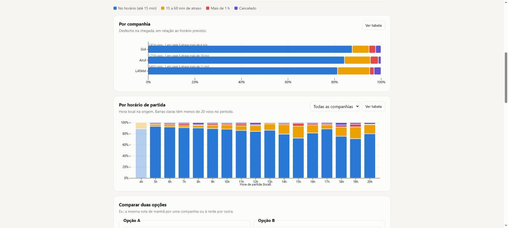
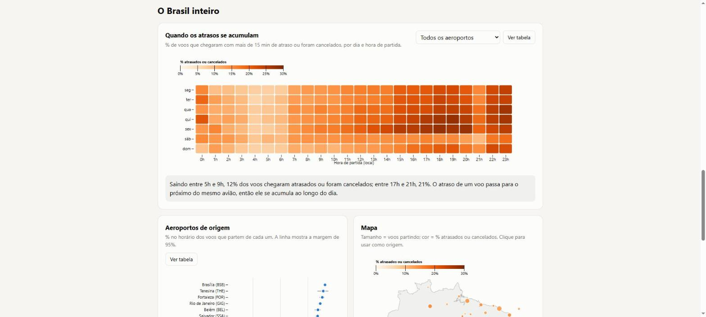

# Atraso — how late does your flight usually run?

An interactive explorer of on-time performance for **every regular domestic flight in Brazil**,
built on ANAC's open data. Pick a route and see how each airline and each departure hour performed
over the last 12 months, compare two options, and see when delays pile up across the country.

**Live:** https://bernardobonecher.github.io/atraso/ · The interface is in Portuguese, because it is made
for people flying in Brazil.


## The problem

Booking sites show price and duration, never reliability. If you have a connection, a meeting or a
long drive after landing, the useful question is *"how often does this flight arrive on time?"* The
answer exists in public data, but it is spread over a million rows of monthly CSV files.

**Who it's for:** people choosing between flights on the same route, and anyone curious about which
airports and times of day work best.

## What it does

| | |
|---|---|
| **Route view** | Share of flights that arrived on time, 15–60 min late, over 1 h late, or were cancelled, per airline |
| **By departure hour** | The same breakdown for each local departure hour, with thin samples faded out |
| **Compare two options** | Airline + time of day vs. another, with 95% intervals and a plain-language verdict that says "tie" when the difference could be chance |
| **Brazil-wide heatmap** | Weekday × hour of the share of flights that arrived late or were cancelled, for all airports or one |
| **Airport ranking** | On-time share per origin airport with its 95% interval |
| **Map** | Airports sized by departures and colored by late/cancelled share; click to use as origin |

Every chart has a table view, works in light and dark mode, and fits a 390 px phone screen.




## What the data shows (Sep 2025 – Aug 2026, 785,569 flights)

- **82.9%** of regular domestic flights arrived within 15 minutes of schedule; **1.7%** were cancelled.
- **Delays build up over the day.** Of flights departing 5–9 am, 12% arrived late or were cancelled;
  of those departing 5–9 pm, 21%. One aircraft flies several legs a day and carries its delay forward.
- **Airports differ more than airlines.** Among origins with 3,000+ departures, Brasília (88.1%) and
  Fortaleza (87.6%) lead; São Paulo–Guarulhos is last at 72.8%.

These are descriptive figures for the period, not predictions for a given flight.

## How it works

```
ANAC VRA monthly CSVs (~12 MB each)  ─┐
OurAirports airport list             ─┤→ pipeline/build.py ─→ site/data/*.json (~560 KB) ─→ static site
                                      ┘     pandas              meta · routes · heat          Observable Plot
```

- `pipeline/fetch.py` downloads the 12 monthly files and the airport list (skips what is already there).
- `pipeline/build.py` filters, classifies and aggregates into three small JSON files.
- `site/` is plain HTML, CSS and one JavaScript module. No build step; charts use
  [Observable Plot](https://observablehq.com/plot/) from a CDN.

## Decisions

**Measure on arrival, not departure.** A traveler cares about when they land. On time means arriving
no more than 15 minutes after the scheduled arrival, the usual industry threshold.

**Cancellations are their own outcome.** Dropping them would make airlines that cancel more look
better. They sit in the same 100% bar as the delays.

**Honest small numbers.** Routes with fewer than 30 flights in the period are left out; departure hours
with fewer than 20 flights are faded; comparisons and rankings show a 95% Wilson interval, and the
comparison only declares a winner when the intervals don't overlap.

**Local time at the origin.** ANAC reports every timestamp in Brasília time, whatever the airport.
I found this by checking the data, not the documentation: São Paulo–Congonhas, which has a night
curfew, only shows departures between 6 am and 10 pm, and Guarulhos→Manaus and Manaus→Guarulhos have
nearly the same scheduled duration (235 and 240 min), which only holds if both ends use one clock. The pipeline shifts each flight to its origin's time zone (Manaus −1 h,
Rio Branco −2 h, Fernando de Noronha +1 h; Brazil has had no daylight saving time since 2019).

**Pre-aggregate, then ship static files.** A million rows don't belong in a browser. Aggregating by
route × airline × hour keeps the whole site under 600 KB of data and free to host.

**One color system, checked for color blindness.** The four outcome colors were validated for
adjacent-pair separation under protanopia, deuteranopia and tritanopia in both themes. The heatmap and
the map encode the same measure, so they share one scale.

## Data quality notes

Checked on the full year before trusting any number:

- 1,781 rows carry milliseconds in their timestamps (`12:25:00.000`) and some fields are the literal
  string `null`. Both are parsed explicitly; the pipeline fails loudly instead of silently dropping rows.
- Rows that look like duplicates are unscheduled extra flights (no scheduled time, authorization code
  other than `0`); only regular scheduled flights (code `0`) are kept.
- Route totals were cross-checked against an independent standard-library recount of the raw files.

## Limitations

- Airlines report the data to ANAC; it is not independently audited.
- No delay reasons: the justification field is `N/A` for every flight in the period.
- A cancelled flight's passengers may have been rebooked; that isn't visible.
- Direct flights only. Connections are out of scope.

## Run it

Requires Python 3.10+.

```bash
pip install -r requirements.txt
python pipeline/fetch.py        # ~150 MB into data/raw (not committed)
python pipeline/build.py        # writes site/data/*.json (committed)
python -m pytest                # 21 tests on the pipeline rules
python -m http.server 8000 -d site
```

Then open http://localhost:8000. A different window: `python pipeline/fetch.py 2025-01 2025-12`.

## Data and credits

- Flights: [ANAC — Voo Regular Ativo (VRA)](https://www.gov.br/anac/pt-br/assuntos/dados-e-estatisticas/historico-de-voos), Brazilian open government data.
- Airports: [OurAirports](https://ourairports.com/data/), public domain.
- Map outline: [world-atlas](https://github.com/topojson/world-atlas) (Natural Earth).

Built with Claude Code. The product and data decisions are documented above, including the
assumptions that turned out wrong and how they were caught.

Code under the [MIT License](LICENSE).
